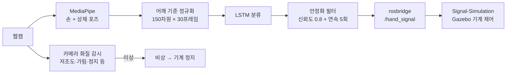
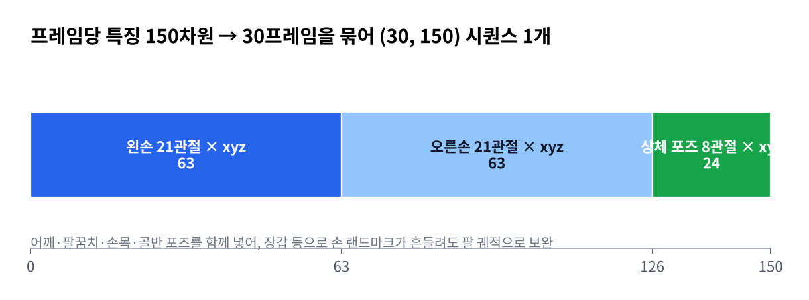
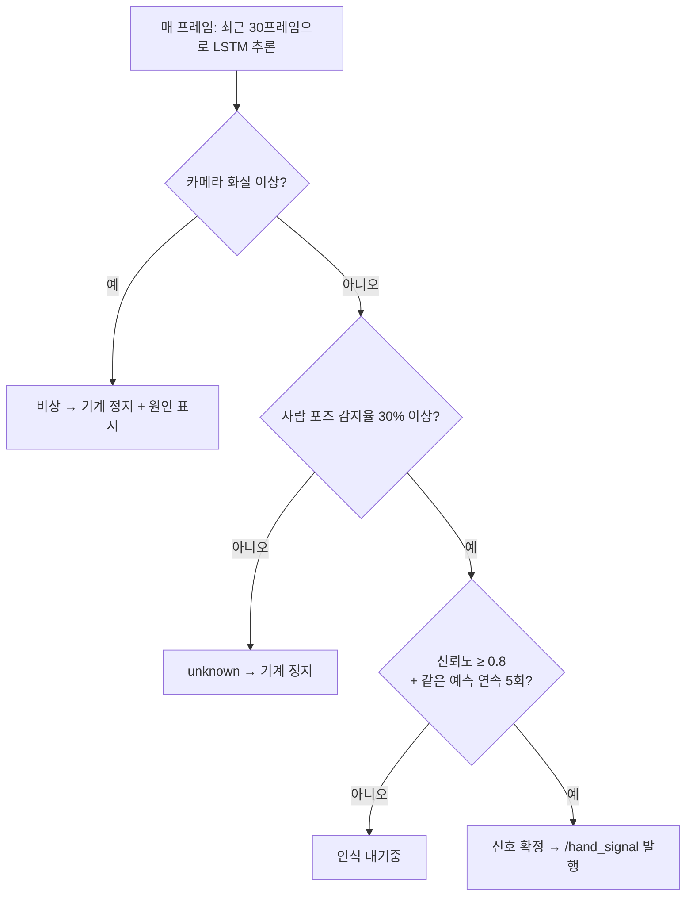
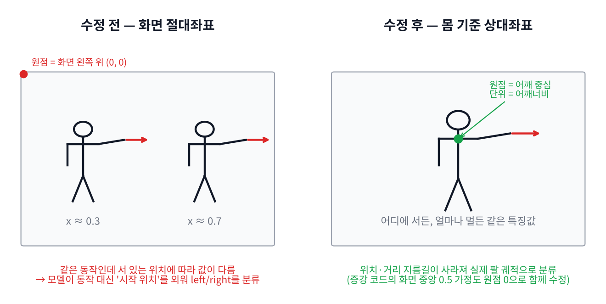
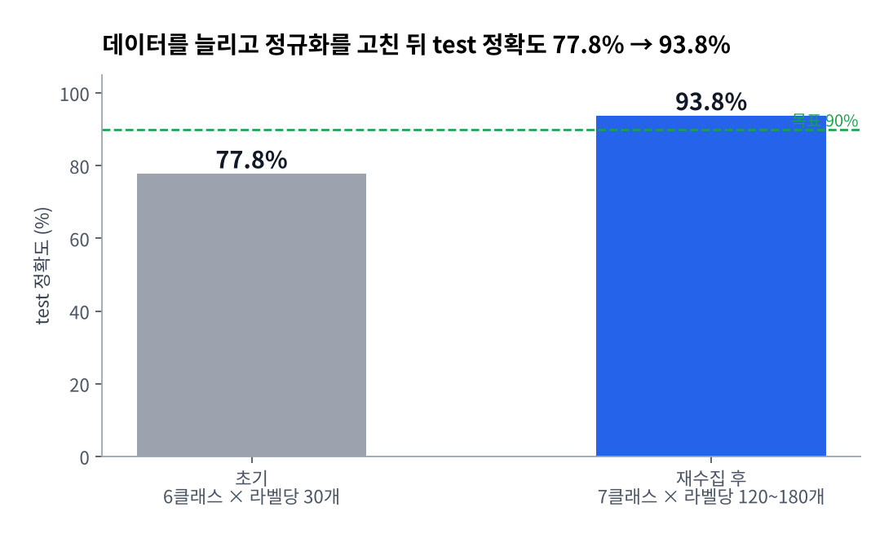
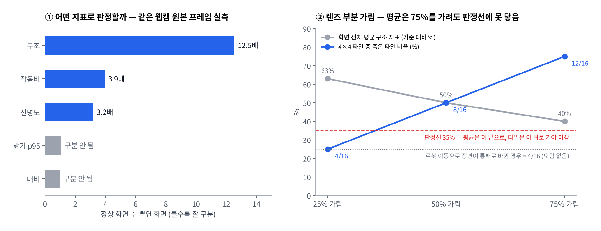

# Signal-Vision

**웹캠으로 작업자의 산업 수신호를 실시간 인식해 공정 기계에 명령으로 넘기는 모듈** — "멈춰", "천천히", "이리 와" 같은 수신호를 MediaPipe 랜드마크 + LSTM으로 분류하고, 카메라 자체에 이상이 생기면 스스로 감지해 기계를 세웁니다.


> K-NAVI 팀 프로젝트(공정 재해 대비 수신호 인식 + 장애물 감지 로봇 시뮬레이션)의 한 저장소입니다.
> 이 저장소는 **인식 결과를 내보내는 데까지** 책임지고, ROS 2·Gazebo 기계 제어는 [Signal-Simulation](https://github.com/SAX-AI-TeamProject1/Signal-Simulation), 장애물 인식은 [Signal-transport-perception](https://github.com/SAX-AI-TeamProject1/Signal-transport-perception)이 담당합니다.



---

## 핵심 결과

| 항목 | 결과 |
|---|---|
| 인식 클래스 | 7종 — `stop` `slow` `come` `back` `left_go` `right_go` `idle` |
| 분류 정확도 | test **77.8% → 93.8%** (데이터 재수집 + 좌표 정규화 버그 수정) |
| 악조건 강건성 | 노이즈·손 소실·동작 속도·위치·렌즈 왜곡 5종 + 종합 조건에서 정확도 하락 **2%p 이내** (`stress_test.py`, 초기 모델 측정) |
| 카메라 이상 감지 | 저조도·빛반사·화면 뭉개짐·해상도 변경·흐림·가려짐·노이즈·**부분 가림**·화면 정지 9종 |
| End-to-end 실증 | 웹캠 → rosbridge → ROS 2 → Gazebo 기계가 실제로 정지·감속·접근 |
| 배포 | Signal-Simulation이 `pip install`로 가져다 쓰는 버전 관리 패키지 (v1.1.2) |

---

## 설계

### 특징: 손만이 아니라 팔 궤적까지



산업 수신호는 손가락 모양보다 **팔을 어떻게 젓는지**가 본체입니다. 그래서 양손 랜드마크(126)에 어깨·팔꿈치·손목·골반 포즈(24)를 더했습니다. 목장갑을 껴서 손 랜드마크가 흔들려도 몸 전체 스케일의 포즈가 보완합니다. 수집·학습·추론이 모두 같은 추출기(`src/capture/extractor.py`)를 써서 특징 형식이 어긋나지 않게 했습니다.

### 실시간 판정: 확신할 때만 명령을 보낸다



- 동작 중간 프레임마다 예측이 튀는 것을 안정화 필터가 막습니다.
- 안전 원칙: **놓치면 사고**인 `stop`의 재현율을 최우선 지표로 보고, 오탐은 "멈추는 쪽"이면 허용합니다.
- 기계 쪽은 하트비트가 2초 끊기면 무조건 정지합니다 (인식기 프로세스가 죽어도 안전).

---

## 문제 해결 기록

### 1. 동작이 아니라 "서 있는 위치"로 분류하고 있었다



- **증상**: `left_go`/`right_go`가 실제 팔 동작과 무관하게 **화면 오른쪽에서 시작하면 무조건 right, 왼쪽이면 left**로 나옴.
- **원인**: 랜드마크를 화면 절대좌표 그대로 쓰고 있었음. 라벨당 60개 수준의 적은 데이터에서는 팔 궤적보다 "시작 위치"를 외우는 게 모델에게 훨씬 쉬운 지름길이었음.
- **해결**: 어깨 중심을 원점으로, 어깨너비를 단위로 좌표를 정규화. 이어서 **증강 코드가 여전히 화면 중앙(0.5)을 기준으로 스케일·렌즈 왜곡을 걸고 있어** 학습 데이터에 가짜 이동값을 주입하던 문제도 함께 찾아 원점 0으로 수정.
- **교훈**: 특징 표현을 바꾸면 그 값을 소비하는 모든 코드(이번엔 증강)를 같이 점검해야 한다.

### 2. 오프라인 정확도는 높은데 실시간에선 좌우가 뒤집힌다



- **증상**: 오프라인 test는 94~96%인데 실시간에서 신뢰도가 확정 임계값(0.8)을 못 넘거나 left/right가 반대로 나옴.
- **시도**: 모델 구조 변경(마지막 타임스텝 → 전체 평균 결합), 드롭아웃·가중치 감쇠 등 3차례 재학습, 손 좌우 슬롯·카메라 미러 모드·라벨 뒤바뀜 여부를 차례로 점검.
- **발견**: 그 과정에서 **`torch.manual_seed`가 없어 재학습할 때마다 결과가 달라지던** 문제를 찾아 시드를 고정 (재현 가능한 실험의 전제 조건).
- **결론**: 코드가 아니라 여러 번 나눠 재수집하며 깨진 **데이터 일관성**이 원인이라고 판단. 한 세션에서 7클래스 전체를 라벨당 120~180개로 다시 수집 → 방향 반전 사라짐, test **93.8%**.

### 3. 카메라가 고장 나도 "정상"이라고 말하는 판정기



수신호 인식기에서 가장 위험한 상황은 "카메라는 망가졌는데 시스템은 정상이라고 믿는 것"입니다. 기존 판정기는 기동 시 기준치 대비 선명도 하락 하나만 봐서 세 가지 구멍이 있었습니다.

| 구멍 | 원인 | 해결 |
|---|---|---|
| 처음부터 화면이 뿌옇면 영영 침묵 | 나쁜 화면이 그대로 "정상 기준치"가 됨 (웹캠 예열 1~3초와 보정 구간이 정확히 겹침) | 예열 20프레임 폐기 + 표본의 상위 75 백분위 사용 + **기준치 없이 프레임 한 장으로 판정하는 절대 축** 추가, 절대 축이 이상이면 표본 자체를 받지 않음 |
| 저조도에서 지표가 오히려 좋아짐 | 웹캠이 게인을 올려 노이즈가 폭증 → 선명도 지표가 노이즈를 디테일로 읽음 | 같은 웹캠 원본 프레임으로 지표 판별력을 실측(그림 ①), 노이즈에 강한 **구조 지표(12.5배)** 를 중심으로 재구성 |
| 렌즈 절반을 가려도 정상 | 화면 전체 평균이라 75%를 가려도 판정선에 안 닿음 (그림 ②) | 화면을 4×4 타일로 나눠 **죽은 타일 수**로 판정. 로봇 이동으로 장면이 바뀐 경우(4/16)보다 위에 선을 그어 주행 중 오탐 없이 절반 가림을 잡음 |

- 화면이 얼어붙으면 그 안의 사람이 계속 검출되므로, **화면 정지는 인식 결과와 무관하게 단독 판정**합니다. 이때는 축소하지 않은 원본으로 비교합니다 — 축소하면 "살아 있음"을 증명하는 센서 노이즈가 평균에 지워집니다.
- 실측으로 **탈락시킨 지표**도 근거와 함께 소스 주석에 남겼습니다 (무참조 블러 지표는 뿌연 화면을 오히려 더 선명하다고 판정, 에지 방향 기반 기울어짐은 90도 주기 접힘으로 완전 전복을 못 잡음 등).
- 판정 순서 자체가 원인 안내입니다: 어두운 화면은 흐림 지표도 같이 나빠지는데, 그때 "흐림"이라고 하면 사람이 렌즈를 닦으러 갑니다. 그래서 **노출(저조도·빛반사)을 먼저** 보고 원인을 알려 줍니다.

---

## 사용법

### 다른 저장소에서 가져다 쓰기

```bash
pip install "git+https://github.com/SAX-AI-TeamProject1/Signal-Vision.git@v1.1.2"
```

### 셋업

Python **3.12 필수**, 의존성은 `==`로 고정되어 있습니다 (MediaPipe 호환 때문에 numpy 1.x, aarch64 Linux 대응 버전 포함).

- **VSCode**: `Cmd/Ctrl+Shift+B` (빌드 태스크 "프로젝트 셋업") 한 번으로 venv 생성 → 설치 → import 검증까지 자동
- **수동**:
  ```bash
  python3.12 -m venv .venv
  .venv/bin/python -m pip install -e .        # Windows: .venv\Scripts\python
  ```

### 실행

VSCode `Terminal → Run Task`에 모두 등록되어 있고, 터미널에서는 아래처럼 실행합니다.

| 단계 | 명령 | 하는 일 |
|---|---|---|
| 랜드마크 확인 | `python -m src.capture.landmark_viewer` | 웹캠 + 손/포즈 랜드마크 시각화 (프레이밍 점검) |
| 데이터 수집 | `python -m src.dataset.collect --label stop [--samples 90] [--idle]` | 준비 → 녹화 → 저장 자동 반복, 손 감지가 절반 미만인 시퀀스는 버림 |
| 학습 | `python -m src.training.train` | `asset/` 폴더 스캔 → LSTM 학습 → 혼동 행렬 출력 → `models/sign_classifier.pt` |
| 강건성 측정 | `python -m src.training.stress_test` | 악조건별 test 정확도 하락을 정량화 |
| 실시간 추론 | `python -m src.inference.predict --publish rosbridge` | 인식 + `/hand_signal` 발행 (`--publish udp`는 Mac 단독 데모용) |

- 클래스 목록은 코드에 하드코딩하지 않습니다. **`asset/`의 라벨 폴더가 곧 클래스**이고, 학습이 라벨 목록을 모델 파일에 함께 저장하며 추론은 그것만 읽습니다. 새 수신호는 그 이름으로 수집하고 재학습하면 추가됩니다.
- 발행 메시지: `std_msgs/String`에 JSON `{"signal": "stop", "confidence": 0.93, "timestamp": ...}`, 상태 변화 시 즉시 + 1초 주기 하트비트, 서버가 없어도 추론은 계속(자동 재접속).

### 수신호 클래스

| 라벨 | 동작 | 기계 행동 |
|---|---|---|
| `stop` | 손바닥 정면으로 내밀기 | 즉시 정지 |
| `slow` | 손바닥 아래로 눌러 내리기 | 감속 |
| `come` | 손짓해 부르기 | 접근 |
| `back` | 손등으로 밀어내기 | 후진 |
| `left_go` / `right_go` | 좌/우로 팔 젓기 | 선회 |
| `idle` | 평상시 동작 | 직전 상태 유지 (평상시 동작을 신호로 오인하지 않게 하는 필수 클래스) |

---

## 구조

```
src/
├── capture/      특징 추출기(extractor.py), 카메라 화질·화면 정지 감시, 랜드마크 뷰어
├── dataset/      웹캠 자동 수집 UI (collect.py)
├── training/     LSTM 학습(train.py), 특징 수준 증강(augment.py), 악조건 강건성 측정(stress_test.py)
├── inference/    실시간 추론·안정화 필터(predict.py), rosbridge/UDP 발행(publish.py), HUD(ui.py)
└── tools/        VSCode 태스크용 venv·의존성·환경 점검 스크립트
models/           학습된 분류 모델 (sign_classifier.pt)
doc/
├── design.md               아키텍처, 설계 결정, 악조건 운영 범위(ODD)와 고장 유형 대응표
├── ml-flow.md              수집 → 학습 → 추론 플로우, 모델 선택 근거
├── data_collection_log.md  데이터 품질 이슈 원인·대응 기록
└── work.md                 날짜별 작업 기록
```

---

## 남은 과제

- `back` / `come` / `idle` 사이 일부 혼동 — 혼동 쌍 데이터 보강 또는 동작 재정의
- 좌표계 변경 후 증강 강도 상수(노이즈 크기·이동 범위 등)를 새 단위(어깨너비)에 맞게 재튜닝
- 수집 데이터가 소수 인원 기준 — 다중 사용자 일반화 시 사람 단위 분할로 평가
- 역광·저조도·목장갑 착용 조건은 실측 데이터로 추가 검증 필요 (`doc/design.md` ODD 표)
- 카메라가 정확히 90도·180도로 넘어간 경우는 화질 축으로 잡히지 않음 — 별도 자세 감지 채널 필요
